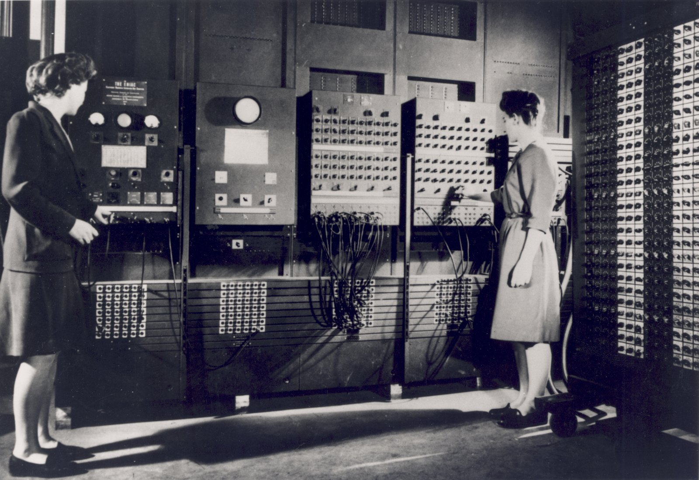
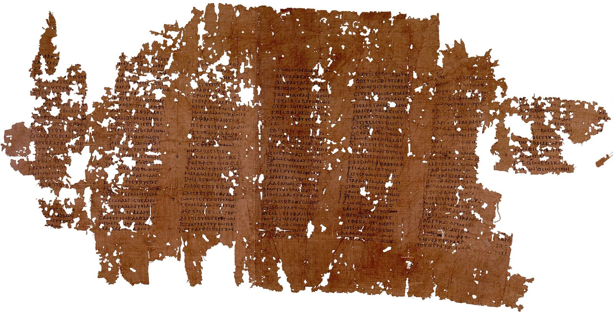
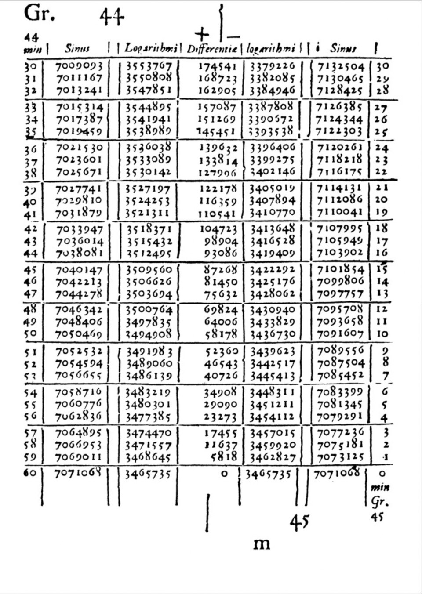
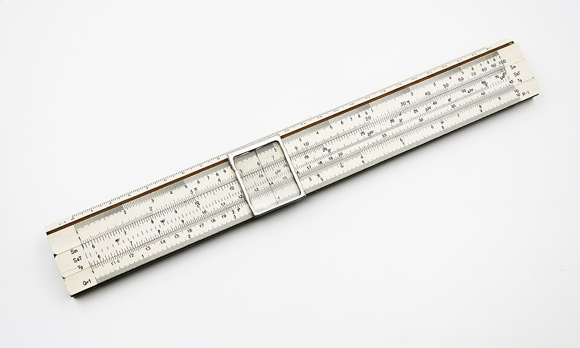
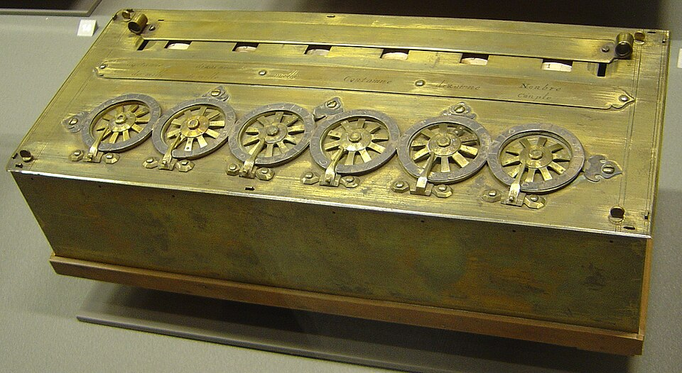
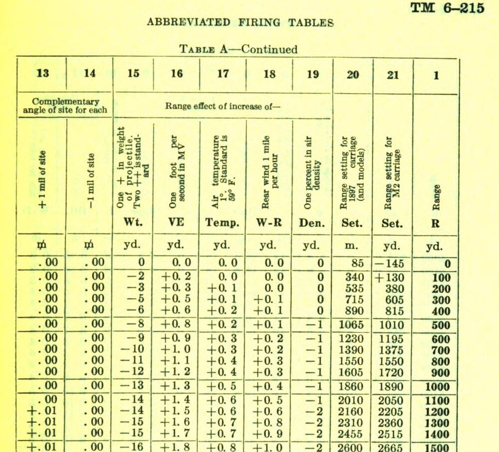
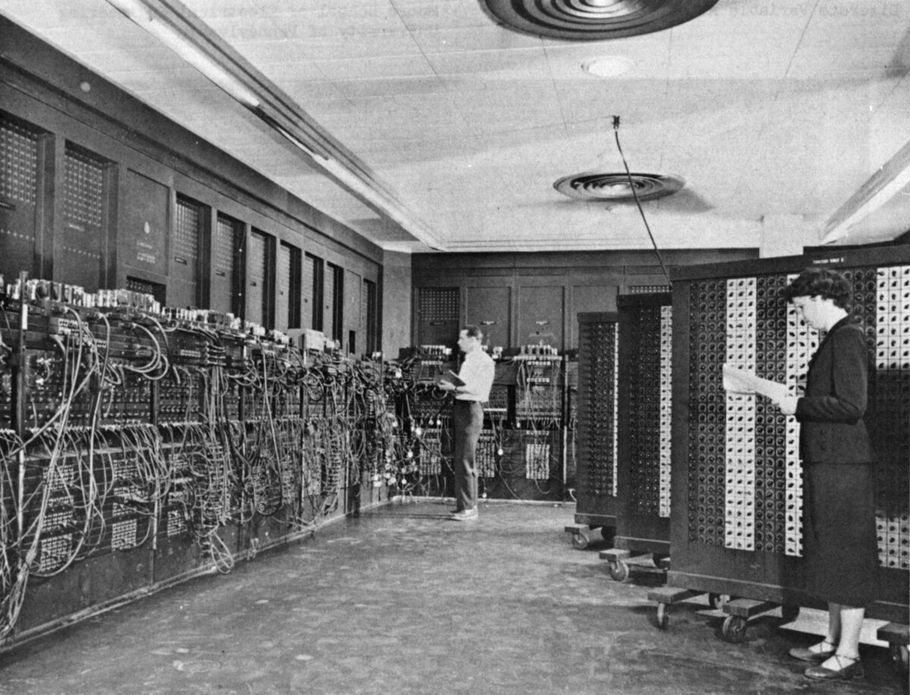
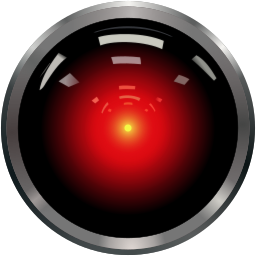

## {.center}

:::: {.columns}
::: {.column width="50%"}
{fig-alt="Dwie kobiety przy panelach ENIAC-a"}

::: caption
ENIAC, 1946: pierwszy elektroniczny komputer ogólnego przeznaczenia
:::
:::
::: {.column width="50%"}
::: event
[8 września 2026]{.date}

jeden problem milenijny\
ok. 10 000 agentów AI, 88 godzin\
166 stron dowodu
:::

::: event
[6 października 2026]{.date}

ok. 4000 otwartych problemów\
722 prace\
udostępnione naraz
:::
:::
::::

::: big
Co wydarzyło się pomiędzy?
:::

::: notes
Na zdjęciu: Betty Jennings (z lewej) i Frances Bilas przygotowują ENIAC-a do pokazu w lutym 1946 (U.S. Army, domena publiczna).

Prawa strona: wyjaśnienie w części „Dowód” (Navier–Stokes, openai/math). Kolejność bloków jest chronologiczna, nie według ważności.
:::

## Kto udowodnił to twierdzenie? {.center}

::: {.ladder-line .otwarcie}
<div><span class="done">rachunek</span><b>1946</b><em>ENIAC liczy</em></div>
<div><span class="pusty">sprawdzanie<br>przypadków</span><b>&nbsp;</b><em>&nbsp;</em></div>
<div><span class="pusty">szukanie</span><b>&nbsp;</b><em>&nbsp;</em></div>
<div><span class="done">dowód</span><b>2026</b><em>agenci AI proponują<br>dowody i&nbsp;kontrprzykłady<br>w&nbsp;otwartych problemach</em></div>
<div><span class="open">pytania<br>teoria<br>zastosowania</span><b>&nbsp;</b><em>&nbsp;</em></div>
:::

::: big
Co po drodze człowiek oddał maszynie?
:::

::: notes
Nawiązanie do slajdu otwierającego. W 1946 maszyna liczyła — dowody prowadzili ludzie. W 2026 maszyna przedstawia 166 stron dowodu dla równań Naviera–Stokesa: kto udowodnił to twierdzenie? Co to za problem i jaki ma status — w części „Dowód”.

Drabina kompetencji: między rachunkiem a dowodem są puste szczeble, które zapełnia reszta wykładu. Każdy przykład odpowiada na pytanie: co w tej historii zrobił człowiek, a co maszyna? Ostatnie pole to nie kolejny szczebel, tylko trzy rzeczy równoległe: stawianie pytań, budowanie teorii i szukanie zastosowań. Z teorii i zastosowań biorą się pytania, a do nich trafiają wyniki. Pole zostaje otwarte — wraca w podsumowaniu.
:::

## Demo {.demo}

:::: {.columns}
::: {.column width="45%"}

:::
::: {.column width="55%"}
::: zadanie-demo
Znajdź **odwracalne odwzorowanie wielomianowe** płaszczyzny, które przestawia te punkty tak, jak pokazują strzałki — o możliwie niskim stopniu.
:::

::: podpowiedz

:::

::: start-demo
Agenci AI zaczynają **teraz**.\
Nikt im nie pomaga.\
Wyniki na końcu wykładu.
:::
:::
::::

::: notes
Drabina z poprzedniego slajdu na żywo: zadanie daje człowiek, resztę — aż do szczebla „dowód” — robią agenci, jak przy Navier–Stokesie. Zadanie z dziedziny prowadzącego: wielomianowe automorfizmy płaszczyzny nad ℚ (te same obiekty co przy hipotezie jakobianowej, która przyjdzie później). Stopień startowy (m − 1)² to znana konstrukcja (dwa odwzorowania trójkątne z interpolacji), liczona bez agentów w etapie 0.

Start eksperymentu przy tym slajdzie; repozytorium `rodakt/demo-automorfizmy`, publiczne. Agenci mają do 38 minut (`CZAS_CALKOWITY_MIN`); w próbach kończyli wcześniej, po ok. 11 minutach, sami uznając pytanie za rozstrzygnięte. Kto pracuje: planista (czyta dziennik i sam stawia sobie zadania pośrednie — to szczebel „dowód” z drabiny), wykonawcy (równolegle), weryfikator (zwykły program, dokładna arytmetyka; agenci nie mogą go zmienić — liczby w raporcie pochodzą tylko od niego). Raport PDF po każdym etapie trafia na GitHub; link na ostatnim slajdzie.

Próby generalne (16 i 22 października, te same punkty): agenci zeszli ze stopnia 16 do 6 i dali dowód wspomagany komputerowo, że nad liczbami wymiernymi niżej się nie da. Na wykładzie zaczynają od zera — nie wiedzą o próbach.
:::

# Delegowanie jest stare {background-color="#1f4e79"}

::: ladder
<span class="now">rachunek</span> <span>sprawdzanie przypadków</span> <span>szukanie</span> <span>dowód</span> <span class="open">pytania · teoria · zastosowania</span>
:::

::: notes
Zanim pojawiły się komputery, ludzie od dawna oddawali część pracy umysłowej narzędziom. Z logicznego punktu widzenia elektronika nic tu nie zmienia: ENIAC nie jest pierwszym krokiem, tylko kamieniem milowym.
:::

## Platon, *Fajdros* {.platon}

{fig-alt="Postrzępiony brązowy papirus z sześcioma kolumnami greckiego pisma"}

::: {.caption .zrodlo}
*Fajdros* na papirusie z Oksyrynchos (Egipt), II–III w. n.e.
:::

::: thamus
Król Thamus o piśmie: ludzie przestaną ćwiczyć pamięć, bo zaufają zapisanym znakom.
:::

::: big
Wiemy o tym tylko dzięki pismu.
:::

::: notes
Ok. 2400 lat temu Platon opisuje, jak egipski król ocenia wynalazek pisma. Parafraza, nie cytat.

Obawa przed oddaniem pamięci narzędziu przetrwała, bo ktoś ją zapisał — na papirusie z Egiptu, tam gdzie toczy się opowieść.

Przez następne 2400 lat delegowanie nie wyjdzie poza papier i rachunek.
:::

<!--
Decyzje (19.10.2026): slajd zostaje osobno (nie wchodzi do „Przed elektroniką”), dostał obraz zamiast samego tekstu. Usunięte „najstarszy znany zapis obawy przed oddaniem kompetencji narzędziu” — superlatyw nie do sprawdzenia. Nawiązanie na końcu: wiersz „pismo, tablice, maszyny” w siatce „Kto udowodnił to twierdzenie?” (ok. 2400 lat w jednym wierszu); obawa wraca przy kolejnych szczeblach dopiero w ostatnich dekadach.

Papirus: na papirusie jest inny fragment dialogu, nie mit o Thamusie (ok. 274c–275b) — poglądowo. Commons podaje II w.; prawdopodobnie P.Oxy. 1016 (Toledo Museum of Art, połowa III w., Fajdros 227a–230e, na odwrocie lista podatkowa z 235 r.) — do potwierdzenia.
-->


## 347 · 28 na trzy sposoby {.trzy-sposoby}

::::: sposoby
:::: sposob
[w pamięci]{.tytul}



::: udzial
[ ]{.glowa style="width: 100%"}
:::
[człowiek: wszystko]{.opis}
::::
:::: sposob
[pisemnie]{.tytul}



::: udzial
[ ]{.glowa style="width: 60%"}[ ]{.narzedzie style="width: 40%"}
:::
[człowiek: kolejne kroki<br>papier: pamięć]{.opis}
::::
:::: sposob
[kalkulator]{.tytul}



::: udzial
[ ]{.glowa style="width: 6%"}[ ]{.narzedzie style="width: 94%"}
:::
[człowiek: wpisuje liczby<br>maszyna: cały rachunek]{.opis}
::::
:::::

::: notes
W pamięci: sprytny trik (347 · 30 − 347 · 2) — przy liczeniu w pamięci człowiek wybiera też metodę. Pisemnie: człowiek wykonuje cudzy algorytm krok po kroku, papier pamięta wyniki pośrednie i przeniesienia. Kalkulator: człowiek tylko wpisuje liczby. Paski udziału są poglądowe.

Szkoła pilnuje tej granicy: słupek policzony na kalkulatorze to słupek niezrobiony. Celem jest umiejętność, nie wynik. Przy „liczeniu w pamięci” nawet kartka jest wyręczeniem.

Psychologia nazywa to *cognitive offloading* — przenoszenie pracy umysłowej na otoczenie. Clark i Chalmers (1998) pisali wręcz o „umyśle rozszerzonym” o notatnik.

Pytanie, które wraca przy dowodach komputerowych: gdyby w słupku był błąd, a kalkulator pokazał co innego — komu uwierzymy? Przy rachunku zaufanie dawno przeszło na maszynę.
:::

## Przed elektroniką {.przed-elektronika}

::::: os-czasu
:::: os-karta
{.kadr-gora fig-alt="Strona tablic logarytmów Napiera: kolumny sinusów i logarytmów dla kąta 44°"}

[1614]{.rok} [tablice]{.co}
::::
:::: os-karta
{fig-alt="Suwak logarytmiczny z przezroczystym kursorem"}

[ok. 1620]{.rok} [suwak]{.co}
::::
:::: os-karta
{fig-alt="Pascalina: mosiężna skrzynka z sześcioma kółkami do wybierania cyfr"}

[1642]{.rok} [maszyna]{.co}
::::
:::: os-karta


[ok. 1790]{.rok} [komputer zbudowany z ludzi]{.co}
::::
:::::

::: zrodla
Wikimedia Commons: tablica Napiera — domena publiczna; suwak — Jacek Halicki, CC BY-SA 4.0; Pascalina — David Monniaux, CC BY-SA 3.0
:::

::: notes
**Napier:** logarytm zamienia mnożenie na dodawanie — astronom zamiast mnożyć, sięga do tablicy.

**Suwak:** te same logarytmy w dłoni. *(Inżynierowie używali go do lat 70., astronauci Apollo mieli suwaki na pokładzie.)*

**Pascal:** maszyna sama przenosi dziesiątki — to, co dotąd robiła głowa. *(Budował ją dla ojca, poborcy podatkowego w Rouen; potem Leibniz dołożył mnożenie.)*

**Prony:** podział pracy z fabryki szpilek Adama Smitha przeniesiony na liczenie — najniższe piętro tylko dodaje i odejmuje, nie musi rozumieć matematyki.

*(„Problem trzech ciał” Liu Cixina: w grze w powieści cesarz Qin buduje komputer z 30 milionów żołnierzy — każdy to bramka logiczna, podnosi albo opuszcza flagę. To fikcja; Prony zrobił coś podobnego naprawdę, 200 lat wcześniej, tylko na poziomie dodawania, nie bramek.)*

**Wspólne:** wszystkie przejmują jeden szczebel, rachunek; metoda zostaje przy człowieku. Delegowanie wygląda niewinnie — nikt nie ma problemu z tym, że kalkulator mnoży.
:::

## Tabela strzelnicza {.tabela-strzelnicza}

:::: {.columns}
::: {.column .fragment .fade-out width="50%" fragment-index="1"}
### Bez oporu powietrza



::: wzory
$x = v t \cos\alpha \qquad y = v t \sin\alpha - \tfrac{1}{2} g t^2$

zasięg: $\;R = \dfrac{v^2 \sin 2\alpha}{g}$
:::
:::
::: {.column width="50%"}
### Z oporem powietrza



::: kroki-opis


wzoru nie ma — liczy się krok po kroku:\
**położenie → prędkość → nowe położenie**
:::
:::
::::

::: {.fragment .skan-tabeli fragment-index="1"}
{fig-alt="Fragment amerykańskiej tabeli strzelniczej z 1941 roku: kolumny poprawek zasięgu na masę pocisku, prędkość, temperaturę, wiatr i gęstość powietrza"}

::: {.caption .zrodlo}
US Army, *Abbreviated Firing Tables* (TM 6-215), 1941
:::
:::

::: notes
Ten sam szczebel co tablice i Prony — rachunek — ale w skali, której ludzie już nie udźwignęli.

Lewa strona: bez oporu tor jest parabolą, wszystko daje wzór ze szkolnej fizyki. Najdalej leci pocisk pod kątem 45°, a 15° i 75° lądują w tym samym miejscu.

Prawa strona (w tle przerywane parabole): z oporem tory są krótsze i niesymetryczne — pocisk spada stromiej, niż się wznosił. Najdalej leci już nie pod kątem 45°, tylko ok. 41° (pogrubiony; tor 45° ląduje prawie w tym samym miejscu, więc go nie rysujemy); 15° i 75° lądują w różnych miejscach. Takiego toru nie da się zapisać wzorem — liczy się go krok po kroku (schemat pod rysunkiem, z przesadnie dużym krokiem): z położenia i prędkości nowe położenie, z grawitacji i oporu nowa prędkość, i tak setki razy.

Klik: prawdziwa tabela (działo 75 mm, 1941) zastępuje lewą stronę — zostaje obok toru z oporem, z którego się bierze. Ostatnia kolumna: zasięg co 100 jardów, obok nastawa celownika — to jest właśnie obliczone z góry „gdzie spadnie pocisk”. Kolumny 15–19: o ile jardów zmienia się zasięg, gdy pocisk jest cięższy o jedną klasę wagi, prędkość wylotowa większa o 1 stopę/s, powietrze cieplejsze o 1°F, wiatr w plecy o 1 milę/h, gęstość powietrza większa o 1%. Tor główny liczy się dla warunków wzorcowych (bez wiatru, wzorcowa temperatura i masa), a poprawki osobno. Na analizatorze różniczkowym nie z różnicy dwóch torów (za mała dokładność), tylko z osobnych równań sprzężonych (Bliss); dopiero przy ENIAC-u „łatwiej było policzyć 10 000 torów dla wszystkich warunków”, a — jak mówi Harry Reed z BRL — „te ładne rzeczy na jakiś czas przepadły”. Stąd setki torów na jedną tabelę (analizator w Aberdeen, II–VI 1945: 1560 torów na 10 tabel), a każda kombinacja działa, pocisku, ładunku i zapalnika wymagała nowej tabeli.

Skąd masa: opór hamuje lżejszy pocisk silniej (ta sama siła, mniejsza masa — większe opóźnienie); bez oporu masa nie ma znaczenia.

Parametry rysunku: v = 300 m/s, opór kwadratowy typowy dla pocisku ok. 75 mm (k = 10⁻⁴ 1/m); bez oporu zasięg 9,2 km, z oporem 5,6 km. Rysunek poglądowy, nie konkretne działo.
:::

## Ludzie w roli maszyny {.zawod}

:::: {.columns}
::: {.column width="50%"}
{fig-alt="ENIAC: długi rząd szaf z kablami; Glen Beck i Betty Snyder przy panelach"}

::: caption
ENIAC: Glen Beck i Betty Snyder, ok. 1947–55 (U.S. Army)
:::
:::
::: {.column width="50%"}
::: paski-czasu
[jeden tor pocisku, który leci 60 sekund]{.naglowek}

[człowiek z kalkulatorem biurkowym]{.etykieta} [ ]{.pasek style="width: 100%"} [20 godzin]{.wartosc}

[analizator różniczkowy]{.etykieta} [ ]{.pasek style="width: 1.25%"} [15 minut]{.wartosc}

[ENIAC]{.etykieta} [ ]{.pasek .eniac style="width: 0.04%"} [30 sekund]{.wartosc}

[krócej niż czas lotu pocisku]{.puenta}
:::
:::
::::

::: notes
„Komputer” to był zawód: w Ballistic Research Laboratory i w Moore School w Filadelfii tory pocisków liczyły ręcznie matematyczki zatrudnione jako *computers*. To też delegowanie rachunku — tyle że na ludzi.

Paski są w tej samej skali: 15 minut to 1/80 paska, 30 sekund to 1/2400 — ENIAC liczy tor w połowie czasu, w którym pocisk leci.

ENIAC: ok. 18 tys. lamp, ok. 30 ton. Ukończony 1945, pokazany publicznie w lutym 1946 — nie zdążył na wojnę, ale to wojna go sfinansowała. Program to układ kabli i przełączników, bez instrukcji i języków programowania. Programowało go sześć kobiet: Kay McNulty, Betty Jennings, Betty Snyder (na zdjęciu), Marlyn Wescoff, Fran Bilas, Ruth Lichterman. Na zdjęciach z 1946 często ich nie podpisywano; ich rolę przypomniano dopiero w latach 90.

Analizator różniczkowy: mechaniczna maszyna analogowa Busha (MIT, 1930–31) — kółka toczące się po tarczach całkują, układ wałków odwzorowuje równanie; krzywą oporu wprowadzał operator, ręcznie prowadząc wskaźnik po wykresie. Egzemplarze w Moore School (1934, 14 integratorów) i w Aberdeen (1935, 10 integratorów); oba chodziły dzień i noc przez całą wojnę. Nie zastąpił ludzi, tylko się z nimi dzielił pracą: analizator dawał tory, a z torów kalkulatorami biurkowymi liczono tabelę (Lila Todd Butler: analizator 16 godzin na dobę, dwie zmiany). Mimo to zaległości rosły — ponad 100 liczących i dwa analizatory nie nadążały. Kariera krótka: od początku lat 30. do końca lat 40., potem maszyny cyfrowe.

Kamień milowy: rachunek przechodzi z ludzi na maszynę elektroniczną.

Jedne z pierwszych obliczeń na ENIAC-u, w 1948 roku, to metoda Monte Carlo Stanisława Ulama, matematyka ze Lwowa (szkoła Banacha): zamiast liczyć wszystkie przypadki — losować ich bardzo wiele (pomysł z pytania, jaka jest szansa, że pasjans wyjdzie). Programowała je m.in. Klára Dán von Neumann; zastosowanie: dyfuzja neutronów, Los Alamos.

Źródło czasów: M. H. Weik, „The ENIAC Story”, *Ordnance*, styczeń–luty 1961 (Ballistic Research Laboratories): 60-sekundowy tor — ok. 20 godzin na kalkulatorze biurkowym, 15 minut na analizatorze różniczkowym, 30 sekund na ENIAC-u.
:::

# Sprawdzanie przypadków {background-color="#1f4e79"}

::: ladder
<span class="done">rachunek</span> <span class="now">sprawdzanie przypadków</span> <span>szukanie</span> <span>dowód</span> <span class="open">pytania · teoria · zastosowania</span>
:::

::: notes
Nowy szczebel: maszyna wykonuje część rozumowania. Ludzie dowodzą, że wystarczy sprawdzić skończenie wiele przypadków, a maszyna sprawdza je wszystkie. Różnica względem tabeli strzelniczej: tam każdy wynik jest używany osobno, tu wszystkie przypadki razem składają się na jeden dowód — jeden błędny i dowód upada.
:::

## Cztery barwy

:::: {.columns}
::: {.column width="55%"}
Czy każdą mapę da się pokolorować **czterema** kolorami tak, by sąsiednie kraje się różniły?

- 1852: pytanie stawia Francis Guthrie
- 1879: dowód Kempego
- [1890: Percy Heawood znajduje w nim błąd]{.fragment}
:::
::: {.column width="45%"}


::: {.fragment .mapa-kropki}
:::

::: {.fragment .mapa-kreski}
:::

::: {.fragment .mapa-kropki-kolor}
:::

::: {.fragment .mapa-kolor}
:::
:::
::::

::: notes
Po Heawoodzie mapa zamienia się w graf, krok po kroku:

1. Kropki: każde województwo to jedna kropka. Kształty przestają być ważne.
2. Kreski: wspólna granica = kreska między kropkami. Liczy się tylko, kto z kim sąsiaduje.
3. Kolorowanie kropek (od razu, bez animacji): zadanie brzmi teraz — pokoloruj kropki tak, by końce każdej kreski miały różne kolory. Na grafie dobrze widać pierścień wokół kujawsko-pomorskiego (niżej).
4. Kolorowanie mapy (animacja, ta sama kolejność): każde województwo bierze kolor swojej kropki — pokolorowany graf to pokolorowana mapa. Od teraz pracujemy na grafie.

Ciekawostka sprawdzona rachunkiem: dla mapy Polski trzy kolory NIE wystarczą. Kujawsko-pomorskie otacza pierścień pięciu województw (wielkopolskie → pomorskie → warmińsko-mazurskie → mazowieckie → łódzkie → z powrotem wielkopolskie). Pierścień o nieparzystej długości potrzebuje trzech kolorów, a środek — czwartego.
:::

## Dowód, którego nie da się przeczytać



::: {.fragment .ah-blad}
:::

::: {.fragment .ah-koniec}
:::

::: notes
Appel i Haken, 1976 — nowy szczebel: maszyna sprawdza przypadki. Dowód ma dwie części. Ręczną: ludzie dowodzą, że wystarczy sprawdzić skończoną listę konfiguracji (ponad 400 stron mikrofisz, sprawdzanych ręcznie, m.in. przez córkę Hakena, Dorotheę Blostein). Komputerową: każdą z 1936 konfiguracji (w publikacji z 1977 już 1482) sprawdza komputer, jedna po drugiej — razem 1200 godzin na trzech komputerach.

Na wejściu po obu stronach po jednym przypadku. Lewy panel — prawdziwa strona z artykułu z 1977 (część I, s. 472, Tabela 4, strona 1): 25 odręcznie rysowanych przypadków. W artykule tablice zajmują kilkanaście stron, a do tego suplement na mikrofiszach: 450 stron dalszych rysunków i wyjaśnień. W skrócie: „Ludzie wymyślili zasady przekazywania »punktów« między krajami, tak żeby punkt mógł zostać tylko tam, gdzie leży coś z listy. Sprawdzenie, że tak jest — dziesięć tysięcy przypadków, ręcznie. Tak wyglądała jedna strona.” Prawy panel — przypadek części komputerowej: diament Birkhoffa (1913), najprostsza znana konfiguracja tego typu (jest na liście Robertsona, Sandersa, Seymoura i Thomasa (1996) jako pierwsza z 633 konfiguracji, jedyna z pierścieniem 6; u Appela i Hakena prawie na pewno (7 konfiguracji z pierścieniem ≤ 8; część I, s. 483: „Birkhoff's reducible 5-555 double-triangle”), sama lista jest w mikrofiszach). Jak czytać ten przypadek:

> To jeden przypadek, czyli konfiguracja. Cztery pełne kropki to kraje, które mają po pięciu sąsiadów — i wszystkich widać na rysunku. Ze światem łączy je tylko pierścień sześciu kropek; co jest dalej, nie wiemy. Więc nie wiemy też, jak pierścień zostanie pokolorowany. Trzeba sprawdzić wszystkie możliwości — tu jest ich 31 — i za każdym razem pokazać, że środek da się dokolorować. Jeśli zawsze się da, to takiego fragmentu nie ma w najmniejszej mapie, której nie da się pokolorować.

Uproszczenie: „da się dokolorować” czasem wymaga najpierw przestawienia kolorów na zewnątrz zamianą Kempego (D-redukowalność); szkielet dowodu — w notatkach następnego slajdu. Przy pierścieniu 14 kolorowań jest 199 291. Pełna kropka to symbol Heescha (5 sąsiadów), którego używali Appel i Haken.

Pod diamentem (od początku): „jeden z 1936 przypadków · wszystkie sprawdza komputer”: maszyna sprawdza wszystko. Pytanie: czy dowód, którego żaden człowiek nie przeczyta w całości, jest dowodem? Ówczesny spór.

Klik 1 (krzyżyk na kartkach): 1981, Ulrich Schmidt (RWTH Aachen, praca magisterska) sprawdził ok. 40% części ręcznej i znalazł istotny błąd — w części sprawdzanej przez ludzi, nie przez komputer. Haken poprawił go w dwa tygodnie. Część komputerową niezależnie sprawdzono innymi programami.

Klik 2: 1989 — monografia Appela i Hakena poprawia ten i kilka innych błędów. 2005 — Georges Gonthier i Benjamin Werner zapisują cały dowód w systemie Coq; odtąd trzeba ufać tylko jego małemu jądru.

Błąd był w części ręcznej, nie komputerowej.

Co jest na tej stronie (metoda ładunków):

1. Każdy kraj dostaje punkty: 6 minus liczba sąsiadów (5 sąsiadów: +1; 6: 0; 7: −1; 8: −2). U Appela i Hakena razy 60, żeby dzielić bez ułamków.
2. Z wzoru Eulera suma punktów na każdej mapie wynosi +12.
3. Reguły (487) mówią, kiedy kraj z 5 sąsiadami oddaje część punktu sąsiadowi z 7 lub więcej sąsiadami. Suma się nie zmienia, więc po rozdaniu ktoś nadal ma plus.
4. Reguły ułożono tak, żeby plus mógł zostać tylko tam, gdzie obok leży konfiguracja z listy. Każdy rysunek na tej stronie to jedno takie otoczenie: kółko w środku to kraj z 7 sąsiadami, czarne kropki — kraje z 5 sąsiadami, liczby na krawędziach — przekazany ładunek. Np. −60 + 30 + 20 + 20 = +10: plus został, więc trzeba wskazać konfigurację z listy.
:::

## Cztery lata w pętli



::: {.fragment .petla-nie}
:::

::: {.fragment .petla-tak}
:::

::: notes
Skąd się wzięła lista? Nikt jej nie dostał z góry. Jak powstał dowód Appela i Hakena (1972–1976). Granat — praca ludzi, pomarańcz — maszyny. Wszystkie bloki są już znane z poprzedniego slajdu: przypadki to strony jak ta ze skanu, lista to ściana, a maszyna pyta o to samo co przy diamencie — czy środek da się dokolorować.

Na wejściu: łańcuch. Ludzie układają przepis — na końcu 487 reguł — który wskazuje, które miejsca mapy trzeba obejrzeć. Ludzie oglądają je ręcznie — około 10 000 miejsc — i w każdym wskazują konfigurację. (Technicznie: reguły „rozładowania” — każdy kraj dostaje punkty, 6 minus liczba sąsiadów, a reguły mówią, kto komu je oddaje; obejrzeć trzeba miejsca, gdzie punkty zostają. Szczegóły — w notatkach poprzedniego slajdu.) Z tego wychodzi lista (1936 konfiguracji): każda mapa zawiera coś z listy. Maszyna sprawdza każdą konfigurację z listy: czy jakkolwiek pokolorujemy pierścień, da się dokolorować wnętrze (wprost albo po zamianach Kempego). Przy pierścieniu 14 krajów to 199 291 kolorowań do obsłużenia — dla jednej konfiguracji. Jeśli wszystkie przechodzą, kontrprzykład nie może zawierać niczego z listy — a musi. Sprzeczność.

Klik 1 (strzałka „nie”): gdy konfiguracja nie przechodzi, nie wolno jej skreślić — lista przestałaby być pełna. Trzeba zmienić reguły, a wtedy zmienia się lista. Wersja końcowa różniła się od pierwszej o około 500 poprawek; w 1976 zmieniali reguły co mniej więcej dwa tygodnie, a konfigurację, której maszyna nie potwierdziła w wyznaczonym czasie, wymieniali na inne. Twarda zasada autorów: żadnych konfiguracji z pierścieniem 15 i większym — zamiast nich zmieniali reguły. Komputer nie tylko sprawdzał: do września 1975 to program przeglądał miejsca z dodatnim ładunkiem i szukał w nich obiecujących konfiguracji, a ludzie po każdym znalezionym „defekcie” poprawiali reguły i program. Potem poprawki szły tak szybko, że przegląd przypadków wygodniej było robić ręcznie, a komputer przeszedł na redukowalność. Autorzy: program, który „przez dwa lata wchłaniał nasze pomysły”, zaczął ich zaskakiwać — „zaczął nas uczyć rzeczy, których się nie spodziewaliśmy”.

Klik 2 (wyjście „tak”): czerwiec 1976 — wszystkie konfiguracje z listy potwierdzone. 1200 godzin pracy trzech komputerów IBM; jedna konfiguracja z pierścieniem 14 to około 25 minut. Appel napisał na tablicy wydziału: „Modulo careful checking it appears that four colors suffice”. 22 lipca ogłoszenie.

Szkielet dowodu:

1. Najmniejszy kontrprzykład: każdy kraj ma co najmniej 5 sąsiadów (kraje z 3 sąsiadami dokolorujemy wprost, z 4 — łańcuchem Kempego).
2. Taka mapa zawsze zawiera którąś konfigurację z listy — część ręczna (rozładowywanie, pomysł Heescha).
3. Każda konfiguracja z listy jest redukowalna: każde kolorowanie pierścienia da się przedłużyć do wnętrza, wprost albo po zamianach Kempego — część komputerowa. Przy pierścieniu 14 krajów to 199 291 kolorowań do obsłużenia dla jednej konfiguracji.
4. Najmniejszy kontrprzykład musiałby zawierać coś, czego zawierać nie może — więc nie istnieje.

Przez pierwsze lata budowali listę na wyczucie: brali konfiguracje bez trzech „przeszkód Heescha” (kształtów, które blokują redukowalność), a redukowalność testowali na dobre dopiero od 1975.

Ten rysunek wraca przy FunSearch (dział „Szukanie”): tam bloki w pętli są pomarańczowe — proponuje model językowy — a ludzie stoją nad pętlą. Fakt do zacytowania: Appel i Haken już w 1977 opisali, że przegląd przypadków jest „czysto mechaniczny” i można go oddać programowi — „wtedy praca ręczna polegałaby na podejmowaniu głównych decyzji”; i zapytali: „ale na takim etapie automatyzacji — jak zdefiniować ulepszenie procedury?”. To jest dokładnie pytanie, na które FunSearch odpowiada oceniaczem. [Skojarzenie autora wykładu — opinia.] Reguł dla czterech barw dotąd nikt nie zautomatyzował — także w nowszych dowodach (Robertson i in. 1996, Steinberger 2010) układali je ludzie, a maszyna tylko sprawdzała. Czy maszyna by je wymyśliła — pytanie otwarte.

:::

# Dwie drogi programowania {background-color="#1f4e79"}

## Algorytmiczny i trenowany {.bez-tytulu}



::: notes
Andrej Karpathy (2017) nazwał to Software 1.0 i Software 2.0. Czy trening to programowanie? Według Karpathy'ego tak — programistą jest proces uczenia, człowiek dostarcza dane i cel. Do tego miejsca wykładu uczniowie widzieli wyłącznie paradygmat algorytmiczny. Od części „Szukanie” wchodzi trenowany.

Wiersze rysunku: co pisze człowiek → co jest w środku → skąd wiemy, że działa.

- Po lewej: quicksort, sześć krótkich linii Pythona (a: mniejsze od p, b: reszta). Weź pierwszą liczbę, mniejsze na lewo, resztę na prawo, powtórz. Drzewo pokazuje przebieg dla 5 3 8 1 9 2 7 4 — pogrubiona jest liczba, która w danym kroku dzieli listę. Każdy krok można prześledzić i uzasadnić.
- Po prawej: człowiek też pisze coś krótkiego — regułę uczenia: „popraw każdą wagę trochę w tę stronę, w którą maleje błąd” (∂L/∂w liczy propagacja wsteczna). Do tego 60 000 podpisanych cyfr (zbiór MNIST). Wynik to sieć LeNet-5 (LeCun i in. 1998): 61 706 wag liczbowych, każdy piksel obrazu to jedna z nich (pomarańczowe dodatnie, szare ujemne), warstwa po warstwie. W filtrach pierwszej warstwy coś widać: przejścia jasne–ciemne, czyli proste wykrywacze krawędzi. Dalej — już nic; 3. warstwa to 48 000 liczb, które razem rozpoznają cyfry, ale żadna z osobna nic nie znaczy.
- Puenta: o quicksorcie wiemy z dowodu, że sortuje każdą listę. O sieci wiemy z pomiaru: na 10 000 cyfr, których nie widziała, myli się rzadko — ale „dlaczego” nie umiemy powiedzieć.

Szybkość: quicksort robi średnio rzędu n log n porównań, w najgorszym razie n² — to też jest twierdzenie z dowodem.

Sieć wytrenowaliśmy sami (narzedzia/trenuj_lenet.py, PyTorch, 5 epok, ok. 1,5 min na laptopie); ReLU i max-pooling zamiast oryginalnych tanh i podpróbkowania, liczba parametrów jak w oryginale. Pierwsze 8 cyfr ze zbioru uczącego MNIST. Na rysunku są same wagi, bez 236 biasów; kolory skalowane osobno w każdej warstwie.
:::

## Dwie drogi i matematyka

```{=html}
<svg viewBox="0 0 1180 570" class="timeline" role="img" aria-label="Oś czasu 1946–2026: tor algorytmiczny, tor trenowany i matematyka, w której pomogła maszyna">
  <defs>
    <marker id="grot-alg" viewBox="0 0 10 10" refX="9" refY="5" markerWidth="7" markerHeight="7" orient="auto-start-reverse"><path d="M0,0 L10,5 L0,10 z" fill="#1f4e79"/></marker>
    <marker id="grot-train" viewBox="0 0 10 10" refX="9" refY="5" markerWidth="7" markerHeight="7" orient="auto-start-reverse"><path d="M0,0 L10,5 L0,10 z" fill="#a65a17"/></marker>
  </defs>
  <!-- x = 70 + (rok − 1944) · 13,3; tory: y = 120 (algorytmiczny), 290 (matematyka), 440 (trenowany) -->
  <g class="years">
    <line x1="149.8" y1="40" x2="149.8" y2="560"/><text x="149.8" y="28">1950</text>
    <line x1="415.8" y1="40" x2="415.8" y2="560"/><text x="415.8" y="28">1970</text>
    <line x1="681.8" y1="40" x2="681.8" y2="560"/><text x="681.8" y="28">1990</text>
    <line x1="947.8" y1="40" x2="947.8" y2="560"/><text x="947.8" y="28">2010</text>
  </g>
  <!-- „zima” toru trenowanego: 1969–1986 -->
  <rect x="402.5" y="446" width="226.1" height="118" class="winter"/>
  <text x="515.5" y="556" class="winter-label">„zima”</text>
  <line x1="70" y1="120" x2="1160.6" y2="120" class="lane alg"/>
  <line x1="70" y1="290" x2="1160.6" y2="290" class="lane math"/>
  <line x1="70" y1="440" x2="1160.6" y2="440" class="lane train"/>
  <text x="116" y="150" class="track alg">ALGORYTMICZNY</text>
  <text x="116" y="276" class="track math">MATEMATYKA</text>
  <text x="116" y="426" class="track train">TRENOWANY</text>
  <!-- 2021–2026: szukanie i dowód — zapowiedź dalszej części -->
  <rect x="1094.1" y="266" width="66.5" height="48" rx="6" class="future"/>
  <text x="1082.1" y="284" class="future-label" text-anchor="end">2021–2026</text>
  <text x="1082.1" y="310" class="szczebel" text-anchor="end">szukanie i dowód</text>
  <!-- strzałki: który tor przyczynił się do wyniku -->
  <line x1="96.6" y1="120" x2="96.6" y2="278" class="contrib alg" marker-end="url(#grot-alg)"/>
  <line x1="389.2" y1="120" x2="389.2" y2="278" class="contrib alg" marker-end="url(#grot-alg)"/>
  <line x1="495.6" y1="120" x2="495.6" y2="278" class="contrib alg" marker-end="url(#grot-alg)"/>
  <line x1="1127.4" y1="120" x2="1127.4" y2="263" class="contrib alg" marker-end="url(#grot-alg)"/>
  <line x1="1127.4" y1="440" x2="1127.4" y2="317" class="contrib train" marker-end="url(#grot-train)"/>
  <!-- tor algorytmiczny -->
  <g class="ev alg key"><circle cx="96.6" cy="120" r="8"/><text x="96.6" y="102" text-anchor="middle">1946 ENIAC</text></g>
  <g class="ev alg"><circle cx="242.9" cy="120" r="8"/><text x="262.9" y="102" text-anchor="middle">1957 FORTRAN</text></g>
  <g class="ev alg"><line x1="389.2" y1="120" x2="389.2" y2="80"/><circle cx="389.2" cy="120" r="8"/><text x="389.2" y="68" text-anchor="middle">1968 Macsyma</text></g>
  <g class="ev alg"><circle cx="668.5" cy="120" r="8"/><text x="668.5" y="102" text-anchor="middle">1989 Coq</text></g>
  <g class="ev alg key"><circle cx="987.7" cy="120" r="8"/><text x="987.7" y="102" text-anchor="middle">2013 Lean</text></g>
  <!-- wyniki matematyczne -->
  <g class="ev math"><circle cx="96.6" cy="290" r="9"/><text x="74.6" y="324" text-anchor="start">tabele strzelnicze</text><text x="74.6" y="350" text-anchor="start" class="szczebel">rachunek</text></g>
  <g class="ev math"><circle cx="389.2" cy="290" r="9"/><text x="403.2" y="324" text-anchor="end">algebra</text><text x="403.2" y="350" text-anchor="end">symboliczna</text><text x="403.2" y="374" text-anchor="end" class="szczebel">rachunek</text></g>
  <g class="ev math key"><circle cx="495.6" cy="290" r="9"/><text x="481.6" y="324" text-anchor="start">1976 Appel i Haken</text><text x="481.6" y="350" text-anchor="start" class="sub">cztery barwy</text><text x="481.6" y="374" text-anchor="start" class="szczebel">sprawdzanie przypadków</text></g>
  <!-- tor trenowany; poziomy etykiet dobrane tak, by się nie nakładały -->
  <g class="ev train"><line x1="256.2" y1="440" x2="256.2" y2="466"/><circle cx="256.2" cy="440" r="8"/><text x="266.2" y="488" text-anchor="end">1958 perceptron</text></g>
  <g class="ev train"><line x1="402.5" y1="440" x2="402.5" y2="466"/><circle cx="402.5" cy="440" r="8"/><text x="402.5" y="488" text-anchor="middle">1969 Minsky i Papert</text></g>
  <g class="ev train key"><line x1="628.6" y1="440" x2="628.6" y2="498"/><circle cx="628.6" cy="440" r="8"/><text x="638.6" y="520" text-anchor="end">1986 propagacja wsteczna</text></g>
  <g class="ev train key"><line x1="668.5" y1="440" x2="668.5" y2="466"/><circle cx="668.5" cy="440" r="8"/><text x="658.5" y="488" text-anchor="start">1989 LeNet</text></g>
  <g class="ev train key"><line x1="974.4" y1="440" x2="974.4" y2="466"/><circle cx="974.4" cy="440" r="8"/><text x="984.4" y="488" text-anchor="end">2012 AlexNet</text></g>
  <g class="ev train key"><line x1="1040.9" y1="440" x2="1040.9" y2="498"/><circle cx="1040.9" cy="440" r="8"/><text x="1050.9" y="520" text-anchor="end">2017 transformer</text></g>
  <g class="ev train key"><line x1="1107.4" y1="440" x2="1107.4" y2="530"/><circle cx="1107.4" cy="440" r="8"/><text x="1117.4" y="552" text-anchor="end">2022 ChatGPT</text></g>
  <!-- role torów w bloku 2021–2026 -->
  <g><text x="1115.4" y="213" text-anchor="end" class="rola alg">sprawdza</text><text x="1115.4" y="383" text-anchor="end" class="rola train">proponuje</text></g>
</svg>
```

::: notes
Dwa tory programowania i pośrodku matematyka — tylko to, w czym maszyna pomogła i o czym mówimy na wykładzie. Strzałka mówi, który tor dał wkład. Pod punktami szare nazwy szczebli drabiny: środkowa linia to drabina rozłożona w czasie. Do 2021 roku do matematyki prowadzą strzałki tylko z góry; od 2021 — z obu torów naraz.

Role w bloku 2021–2026 — **trenowany proponuje, algorytmiczny sprawdza**. Trenowany jest twórczy, ale się myli; algorytmiczny jest pewny, ale sam nic nie wymyśli. Każdy wynik z części „Szukanie” i „Dowód” to taka hybryda: AlphaGeometry (model językowy + silnik symboliczny), FunSearch (model + oceniacz napisany przez ludzi), AlphaProof i Navier–Stokes (model + Lean). Algorytmiczny nie tylko sprawdza — jest też podłożem: trenowany działa na kodzie pisanym przez ludzi, na sprzęcie i danych zbudowanych przez świat algorytmiczny.

Zarzut „sieć też jest algorytmem” jest słuszny. W trenowanym człowiek wciąż pisze algorytm, ale tylko algorytm uczenia; algorytm rozwiązania wyłania się z danych. Delegowanie wchodzi o piętro wyżej: człowiek pisze przepis na znajdowanie przepisów (por. slajd „Algorytmiczny i trenowany”).

Tor algorytmiczny:

- 1946 ENIAC: program to kable i przełączniki ułożone przez człowieka.
- 1956 Logic Theorist (konferencja w Dartmouth, narodziny nazwy „AI”): program dowodzi twierdzeń z *Principia Mathematica*. AI zaczyna się po stronie algorytmicznej. (Nie ma go na osi.)
- 1957 FORTRAN: pierwszy szeroko używany język programowania — przepis zapisany prawie jak wzór.
- 1968 Macsyma (MIT, Project MAC): algebra symboliczna — program przekształca wzory, nie tylko liczby: upraszcza, rozkłada, różniczkuje, całkuje. Wynik dokładny i z przepisu. Jej bezpośredni potomek to Maxima (darmowa, można zainstalować samemu); dziś to samo robią Mathematica, Maple, WolframAlpha, CAS w GeoGebrze.
- 1989 Coq: program, który sprawdza dowody — przepis tak jawny, że jest matematyką. W 2005 sprawdzono w nim dowód czterech barw.
- 2013 Lean: w nim formalizuje się dziś dowody z części „Dowód”.

Matematyka:

- Tabele strzelnicze (rachunek): matematyka stosowana — z oporem powietrza równanie ruchu nie ma wzoru na rozwiązanie, więc trzeba liczyć. Nawiązanie do części I. Bez roku na osi: pierwszym zadaniem ENIAC-a były obliczenia dla Los Alamos (koniec 1945), tabele liczył później.
- Algebra symboliczna (rachunek): bez konkretnego wyniku i bez roku na linii matematyki — matematycy i fizycy oddali maszynie rachunek na wzorach. Pierwszymi użytkownikami byli w dużej mierze fizycy: Reduce (Hearn) powstał do rachunków w fizyce cząstek, jeszcze wcześniej Schoonschip Veltmana (1963); Macsymy używano m.in. w mechanice nieba i ogólnej teorii względności. Ten sam szczebel co tabele strzelnicze, tylko na symbolach zamiast liczb. Silnik symboliczny w AlphaGeometry i SageMath w FrontierMath to dalszy ciąg tej linii.
- 1976 Appel i Haken (sprawdzanie przypadków): pierwszy duży wynik, w którym komputera nie da się usunąć z dowodu.
- 2021–2026: szukanie i dowód — o tym dalsza część wykładu. Tu tylko zapowiedź: strzałki z obu torów. Początek 2021, bo wtedy pierwsze wyniki dał tor trenowany: Davies i in. (*Nature*, grudzień 2021 — sieć podsunęła zależności w teorii węzłów i teorii reprezentacji) oraz Wagner (2021 — uczenie ze wzmocnieniem znalazło kontrprzykłady w kombinatoryce).
- Nie ma na osi: 1996 EQP rozwiązuje hipotezę Robbinsa (z lat 30.) — pierwszy głośny otwarty problem rozwiązany przez program; AI w matematyce nie zaczęła się w 2022.

Tor trenowany:

- 1958 perceptron (Rosenblatt): pierwszy „sztuczny neuron”, który uczy się z przykładów.
- 1969 Minsky i Papert pokazują ograniczenia perceptronu; początek „zimy”.
- 1986 propagacja wsteczna (Rumelhart, Hinton, Williams): uczenie sieci wielowarstwowych.
- 1989–98 LeNet (LeCun): sieć czyta odręczne cyfry, np. na czekach — to ta sieć z poprzedniego slajdu.
- 2012 AlexNet: koniec „zimy” — nie dzięki nowej idei, tylko dzięki sprzętowi (GPU) i danym; oba zbudował świat algorytmiczny.
- 2016 AlphaGo: sieć i przeszukiwanie pokonują mistrza go. (Nie ma go na osi.)
- 2017 transformer („Attention is all you need”): architektura dzisiejszych modeli językowych.
- 2022 ChatGPT: modele językowe trafiają do wszystkich.

Przez ponad 60 lat tor trenowany nie dał matematyce żadnego wyniku — dlatego nie ma od niego strzałek przed 2021.
:::

# Szukanie {background-color="#1f4e79"}

::: ladder
<span class="done">rachunek</span> <span class="done">sprawdzanie przypadków</span> <span class="now">szukanie</span> <span>dowód</span> <span class="open">pytania · teoria · zastosowania</span>
:::

::: notes
Człowiek wyznacza przestrzeń poszukiwań i sposób oceny, a maszyna sama szuka w niej rozwiązania. Wyniki są nowe, ale granice poszukiwań ustala człowiek.
:::

## Ile mnożeń naprawdę trzeba?

::: r-stack
::: {.fragment .fade-out fragment-index=1}
$$
\begin{pmatrix} a & b \\ c & d \end{pmatrix}
\begin{pmatrix} e & f \\ g & h \end{pmatrix}
=
\begin{pmatrix} ae + bg & af + bh \\ ce + dg & cf + dh \end{pmatrix}
$$

Ten wzór wymaga **8 mnożeń**. Czy da się mniej?
:::

::: {.fragment fragment-index=1}
:::: {.columns}
::: {.column width="50%"}
::: {.strassen}
$$
\begin{aligned}
M_1 &= (a+d)(e+h)\\
M_2 &= (c+d)\,e\\
M_3 &= a\,(f-h)\\
M_4 &= d\,(g-e)\\
M_5 &= (a+b)\,h\\
M_6 &= (c-a)(e+f)\\
M_7 &= (b-d)(g+h)
\end{aligned}
$$
:::
:::
::: {.column width="50%"}
::: {.strassen}
$$
\begin{aligned}
ae+bg &= M_1+M_4-M_5+M_7\\
af+bh &= M_3+M_5\\
ce+dg &= M_2+M_4\\
cf+dh &= M_1-M_2+M_3+M_6
\end{aligned}
$$
:::
:::
::::

Volker Strassen, 1969: **7 mnożeń**
:::
:::

::: notes
Problem: ile mnożeń naprawdę trzeba, żeby pomnożyć dwie macierze? Szkolny wzór wymaga 8. Klik: Strassen, 1969 — wystarczy 7. Po co to: Strassen płaci za to 18 dodawaniami zamiast 4, więc dla zwykłych liczb nic nie zyskuje. Zysk przychodzi przy dużych macierzach, liczonych kawałkami tymi samymi wzorami: dla 1024×1024 to 7¹⁰ ≈ 282 mln mnożeń zamiast 8¹⁰ ≈ 1,07 mld. Mnożenie macierzy jest sercem grafiki, fizyki i samego uczenia maszynowego.

Lewy górny wyraz: M1+M4−M5+M7 = (ae+ah+de+dh) + (dg−de) − (ah+bh) + (bg+bh−dg−dh) = ae+bg. Wzory sprawdzone w SymPy.
:::

## AlphaTensor (DeepMind, 2022)



::: {.fragment .at-ruch}
:::

::: {.fragment .at-strassen}
:::

::: {.fragment .at-47}
:::

::: {.fragment .at-48}
:::

::: notes
Ludzie zamienili szukanie algorytmu w grę dla jednego gracza. Cztery plansze, po jednej na każdy wyraz wyniku; wiersze to a–d, kolumny e–h. Pełne pole mówi, że ten iloczyn wchodzi do tego wyrazu: plansza ae+bg ma pola a·e i b·g. 8 pełnych pól = 8 mnożeń ze wzoru. Ułożone jedna za drugą dają kostkę 4×4×4 — na takiej kostce grał AlphaTensor (rysunek wg Fawzi i in., Nature 2022, Fig. 1a, tu rozłożony na płasko).

Klik: ruch = jedno mnożenie, tu pierwsze mnożenie Strassena (a+d)(e+h), które wchodzi do ae+bg i cf+dh. Wymnożone daje ae, ah, de, dh — każdy z tych iloczynów trafia do obu wyrazów, więc ruch rusza wiersze a, d × kolumny e, h na dwóch planszach: 8 pól (przerywane obwódki). Trafia tylko w 2 pełne (a·e, d·h); 6 pomarańczowych to nadmiar, np. a·h w ae+bg — tego w wyniku być nie powinno, muszą to zdjąć kolejne ruchy. Granat = składnik, którego jeszcze brakuje; pomarańcz = nadmiar. Dlaczego dwie plansze: (a+d)(e+h) liczymy raz, a używamy w dwóch wyrazach (c₁₁ = M₁ + M₄ − M₅ + M₇, c₂₂ = M₁ − M₂ + M₃ + M₆). Jeden ruch to wybór lewego czynnika (wiersze ze znakami), prawego (kolumny ze znakami) i plansz (też ze znakami, np. (c+d)e wchodzi do c₂₁ z plusem, do c₂₂ z minusem); kosztuje jedno mnożenie bez względu na to, ile obejmuje. Na tym polega cała oszczędność: gdyby iloczyn trafiał tylko do jednego wyrazu, nie zeszłoby się poniżej 8; ceną jest nadmiar.

Klik: pozostałe 6 ruchów Strassena idzie samo (co ok. 1,6 s): pól zostaje 12, 12, 10, 8, 4, 0. Plansze puste = wybrane mnożenia dają dokładnie wynik ze wzoru; 7 ruchów = 7 mnożeń. Sprawdzone rachunkiem w skrypcie (assert). Minus w nawiasie (np. a(f − h)) znaczy, że pola z kolumny h ruch dokłada zamiast zdejmować. Sieć AlphaTensor uczyła się w tę grę grać jak AlphaGo w go — na większych planszach. Kto co zrobił: człowiek wymyślił grę i zasady oceny, maszyna znalazła ruchy.

Dla 4×4: wzór 64, Strassen zastosowany dwa razy 7 · 7 = 49. Klik: AlphaTensor 47 — ale tylko w arytmetyce modulo 2 (1 + 1 = 0), pierwsza poprawa w tym przypadku od 1969. Klik: AlphaEvolve (2025, model językowy, który pisze programy szukające) — 48 dla zwykłych liczb, ale ze współczynnikami zespolonymi.

Znaki a modulo 2: gra 2×2 na rysunku i Strassen działają w każdej arytmetyce (współczynniki ±1, stąd dwa kolory). Modulo 2 jest −1 = 1, ruch tylko przełącza pole, „brakuje” i „nadmiar” to to samo — ta swoboda daje 47, ale ten rozkład nie działa dla zwykłych liczb. Dla zwykłych liczb AlphaTensor szukał ze współczynnikami z {−2, …, 2}.

Czy 47 i 48 to optimum — nie wiadomo. Dla 2×2 udowodniono, że 7 jest najmniej (Winograd 1971; Hopcroft i Kerr 1971, także modulo 2). Dla 4×4 udowodnione dolne ograniczenia to ok. 29 (wzory ogólne: Bläser (5/2)n² − 3n = 28, Landsberg i Michałek dla rzędu brzegowego 2n² − log₂n − 1 = 29 — podstawienie n = 4 moje), więc prawda leży gdzieś między ~29 a 47/48. Problem otwarty, jest na liście Epoch AI ([epoch.ai](https://epoch.ai/frontiermath/open-problems/matrix-multiplication); [Landsberg, Michałek](https://par.nsf.gov/servlets/purl/10094859)).

Pętla między paradygmatami: trening sieci to w środku głównie mnożenie macierzy. Trenowany AlphaTensor ulepsza algorytmiczny przepis, na którym sam działa.

Człowiek odbija piłeczkę: tydzień po AlphaTensor Manuel Kauers i Jakob Moosbauer (Linz) poprawili jego wynik dla 5×5 modulo 2 z 96 do 95 mnożeń, startując od algorytmu AlphaTensor i przeszukując komputerem bez uczenia („flip graphs”). W 2025 Dumas, Pernet i Sedoglavic przerobili algorytm AlphaEvolve na 48 mnożeń ze współczynnikami wymiernymi — działa wszędzie, gdzie da się dzielić przez 2, czyli dla zwykłych liczb, ale nie modulo 2 ([arXiv 2506.13242](https://arxiv.org/abs/2506.13242)).
:::

## FunSearch (DeepMind, 2023)

[Punkty o 8 współrzędnych, każda 0, 1 albo 2. Ile da się wybrać, by żadne trzy nie leżały na jednej prostej $\{p,\ p+v,\ p+2v\}$ ($p, v \in \mathbb{Z}_3^8$, $v \neq 0$)?]{.fs-pytanie}



::: {.fragment .fs-petla}
:::

::: {.fragment .fs-powrot}
:::

::: {.fragment .fs-wynik}
:::

::: notes
Prosta jest tu w sensie ℤ₃⁸: punkt p plus wielokrotności wektora kierunkowego v ≠ 0, jak w szkole — ale p + 3v = p, więc na prostej są tylko trzy punkty i czwarty nie wejdzie. Kryterium do sprawdzania: trzy różne punkty a, b, c leżą na jednej prostej wtedy i tylko wtedy, gdy a + b + c ≡ 0 (równość wektorów = 8 równań, po jednym na współrzędną), bo p + (p + v) + (p + 2v) = 3p + 3v = 0; w drugą stronę trzeci punkt prostej przez a i b to 2b − a = −a − b. Tak to sprawdza nasz skrypt (szkielet z rys. 2a artykułu): po wzięciu punktu blokuje −a − b dla każdej pary z już wziętymi. Takich prostych jest więcej niż zwykłych, bo „zawijają się”: na płaszczyźnie (0,0), (1,2), (2,1) to prosta (sumy 3 i 3), choć na kartce nie. W drugą stronę zawsze działa — zwykła prosta przez trzy punkty siatki to też prosta w ℤ₃. Dlatego warunek jest ostrzejszy: na siatce 3×3 bez zwykłej prostej da się wybrać 6 punktów, w sensie ℤ₃² tylko 4. To tzw. cap set.

Na wejściu (bez pętli): wymiar 2, duża siatka 3×3 (oś y w górę). Pomarańczowe (0,0), (1,0), (0,1), (1,1) — żadne trzy na prostej; piątego dołożyć się nie da, każde wolne pole domyka prostą z dwoma pomarańczowymi (sprawdzone w skrypcie). Granatowe obwódki: (1,0), (0,1), (2,2) — prosta zawinięta, na kartce nie wygląda na prostą. Wymiar 2: 4 punkty; wymiar 8: 6561 punktów do wyboru.

Klik 1: siatka znika, wchodzi pętla. Ten sam rysunek co „Cztery lata w pętli”, ale granat przeniósł się nad pętlę. U Appela i Hakena proponowali ludzie (reguły, lista), a maszyna sprawdzała. Tu proponuje model językowy, a ludzie zbudowali pętlę: wybrali problem, napisali oceniacz i szkielet programu. Model pisze tylko jedną funkcję — „który punkt wziąć jako następny?” — a program zachłannie bierze punkty, póki nie powstanie prosta. Autorzy: szkielet oddaje modelowi „dokładnie tę część, którą zwykle najtrudniej wymyślić”, a model to „twórczy rdzeń FunSearch”. „Prosta” w tej przestrzeni się zawija (rys. 3 w artykule: ℤ₃², 4 punkty). Optimum znane tylko do wymiaru 6; w wymiarze 8 możliwości jest rzędu 3^1600 — przeglądu nie da się zrobić.

Klik 2: najlepsze programy wracają do modelu jako wzór, model pisze następne. Model językowy Codey (PaLM 2), bez dostrajania; w całej pracy rzędu miliona próbek. Gwarancji, że coś się znajdzie, nie ma — ale oceniacz jest zwykłym, deterministycznym programem napisanym przez ludzi, więc każdy wynik jest sprawdzony. Tak samo jak u Appela i Hakena: pętla nie miała gwarancji końca, a sprawdzanie było pewne. Różnica jest w tym, kto proponuje.

Klik 3: w wymiarze 8 — 512 punktów i od razu przerywana strzałka „czytają program”; dotąd najlepsze znane 496. To konstrukcja, nie dowód, że więcej się nie da — dlatego to „szukanie”. Wynikiem nie jest lista 512 punktów, tylko program, który je buduje — da się go przeczytać.

Druga pętla (ta sama strzałka): ludzie przeczytali znalezione programy, zauważyli w nich symetrię i przebudowali szukanie — w powiązanym problemie (zbiory dopuszczalne) poprawili dolne oszacowanie stałej opisującej wzrost cap setów z 2,2180 do 2,2202; autorzy: największa poprawa od 20 lat. Artykuł: „człowiek i szukanie stale w pętli”. Człowiek wciąż jest w pętli, ale piętro wyżej: nie układa reguł, tylko buduje maszynę, która je układa, i czyta, co z niej wyszło.

[Opinia autora wykładu] U Appela i Hakena komputer był wyrafinowanym kalkulatorem: sprawdzał przypadki przepisem, który się nie myli (choć do 1975 pomagał też szukać konfiguracji). Tu część pracy twórczej — proponowanie — przeszła na maszynę. Appel i Haken w 1977 pytali: „na takim etapie automatyzacji — jak zdefiniować ulepszenie procedury?”. FunSearch odpowiada: oceniaczem. Czy tak dałoby się wymyślić reguły dla czterech barw — nikt tego nie zrobił.

Źródło: Romera-Paredes i in., „Mathematical discoveries from program search with large language models”, Nature 625 (2024), online 14 XII 2023; współautor-matematyk Jordan Ellenberg.
:::

## Co napisał model?



::: {.fragment .fs-znaleziona}
:::

::: {.fragment .fs-symetria}
:::

::: notes
Przepis od człowieka (w artykule „szkielet”): przejrzyj wszystkie 6561 punktów od najwyższej oceny i bierz punkt, jeśli nie domyka prostej z dwoma już wziętymi. Funkcja `priority` daje tę ocenę — i tylko ją pisze model. Start od ludzi: `return 0.0`, wszystkie punkty równe; ten sam szkielet bierze je wtedy po prostu po kolei i zbiera 256. Po kolei znaczy: remisy w kolejności leksykograficznej, odwróconej (`np.argsort(…, kind='stable')[::-1]`), czyli od (2,…,2) w dół. Wychodzi dokładnie kostka {1, 2}⁸ = 2⁸ = 256 (sprawdzone w skrypcie) — bez prostej, bo trzy liczby z {1, 2} sumują się do wielokrotności 3 tylko wtedy, gdy są równe. Na wstawce ℤ₃² to samo, przesunięte: {0, 1}². FunSearch musiał wyjść poza kostkę.

Klik 1: funkcja, z którą FunSearch zebrał 512 w wymiarze 8 (rys. 4b w artykule; pominięte tylko adnotacje typów w nagłówku). Na slajdzie wycinek: 11 z 33 wierszy, żeby kod był czytelny z sali; pełna funkcja na końcu tych notatek. Obie liczby — 256 i 512 — policzył nasz skrypt: uruchomił obie funkcje w szkielecie z artykułu i sprawdził, że w wyniku nie ma trzech punktów na prostej. Wygląda jak kod pisany przez człowieka, który próbował różnych rzeczy: mnoży przez 1,5 i 0,5, liczy zera. Ale da się ją przeczytać, czego nie da się powiedzieć o 512 punktach albo o wagach sieci.

Klik 2: wiersze z `el[i] == el[-i]` — porównanie i-tej współrzędnej z i-tą od końca. Autorzy zwracają na to uwagę pod rysunkiem; z tej obserwacji ręcznie zbudowali ten zbiór na nowo (rys. 4c: wzór na 512 punktów bez żadnego szukania), a w problemie zbiorów dopuszczalnych symetria odczytana z programu pozwoliła zawęzić szukanie i dojść do 2,2202. To jest strzałka „czytają program” z poprzedniego slajdu.

„Prosta” — trzy różne punkty x, y, z z x + y + z = 0 w każdej współrzędnej modulo 3; dla dwóch punktów trzeci jest wyznaczony jednoznacznie.

Pełna funkcja znaleziona przez model:

```python
def priority(el, n):
  score = n
  in_el = 0
  el_count = el.count(0)

  if el_count == 0:
    score += n**2
    if el[1] == el[-1]:
      score *= 1.5
    if el[2] == el[-2]:
      score *= 1.5
    if el[3] == el[-3]:
      score *= 1.5
  else:
    if el[1] == el[-1]:
      score *= 0.5
    if el[2] == el[-2]:
      score *= 0.5

  for e in el:
    if e == 0:
      if in_el == 0:
        score *= n * 0.5
      elif in_el == el_count - 1:
        score *= 0.5
      else:
        score *= n * 0.5 ** in_el
      in_el += 1
    else:
      score += 1

  if el[1] == el[-1]:
    score *= 1.5
  if el[2] == el[-2]:
    score *= 1.5

  return score
```
:::

# Dowód {background-color="#1f4e79"}

::: ladder
<span class="done">rachunek</span> <span class="done">sprawdzanie przypadków</span> <span class="done">szukanie</span> <span class="now">dowód</span> <span class="open">pytania · teoria · zastosowania</span>
:::

::: notes
Człowiek daje już tylko treść problemu. Maszyna prowadzi całe rozumowanie, łącznie z pytaniami pośrednimi: konstrukcjami pomocniczymi i lematami. Przy człowieku zostaje sprawdzenie i zrozumienie. Przy każdym wyniku mówimy, na ile jest sprawdzony.
:::

## Olimpiada



::: {.fragment .ol-2025}
:::

::: notes
Międzynarodowa Olimpiada Matematyczna (IMO): sześć zadań po 7 punktów, dwa dni po 4,5 godziny. Na rysunku dwie olimpiady na tej samej skali: kwadrat to zadanie, wypełniony — rozwiązane na pełne punkty.

- Na wstępie, jednym zdaniem: styczeń 2024, AlphaGeometry — 25 z 30 zadań geometrycznych z olimpiad 2000–2022; złoty medalista rozwiązywał średnio 26 (25,9; nie było prawdziwego konkursu, każdy zawodnik liczony tylko na zadaniach ze swojego roku). To ilustracja kliku na osi czasu („Dwie drogi i matematyka”): model językowy proponuje konstrukcję pomocniczą („poprowadź tu okrąg”), silnik symboliczny ściśle wyprowadza wnioski. **Konstrukcja pomocnicza to pytanie pośrednie, które maszyna stawia sobie sama** — w drodze do celu, który dał jej człowiek. To jest szczebel „dowód”. Treść zadań autorzy przełożyli na jego język geometrii; mieścił się w limicie czasu zawodników.
- Lipiec 2024, AlphaProof + AlphaGeometry 2: zadania 1, 2 i 6 (algebra, teoria liczb) rozwiązał AlphaProof, zadanie 4 (geometria) AlphaGeometry 2; obu zadań z kombinatoryki (3 i 5) nie. 28/42, srebro; złoto od 29, zabrakło punktu. Zadanie 6 było najtrudniejsze: rozwiązało je pięciu zawodników. Ludzie przełożyli treść zadań na Lean, język formalnych dowodów; jedno zadanie system rozwiązał w kilka minut, nad innymi pracował do trzech dni. To czas pracy, nie limit: zawodnicy mają 2 × 4,5 godziny na wszystkie sześć.
- (klik) Lipiec 2025, Gemini Deep Think: zadania 1–5, bez 6 (kombinatoryka); 35/42, złoto (od 35). Sam czyta treść po angielsku, pisze dowody zwykłym językiem, w regulaminowym czasie; prace ocenili koordynatorzy IMO. Model eksperymentalny OpenAI: też 35/42, też bez zadania 6, ogłoszony tego samego dnia.
- Puenta, bez kliku: rok później o jedno zadanie więcej, ale przede wszystkim bez pomocy ludzi i w czasie zawodników.

Progi medalowe: 2024 — złoto 29, srebro 22, brąz 16; 2025 — złoto 35, srebro 28, brąz 19 (UKMT).
:::

## FrontierMath



::: notes
FrontierMath (Epoch AI, listopad 2024): kilkaset niepublikowanych zadań układanych przez matematyków; każde ma jedną sprawdzalną odpowiedź (np. liczbę), więc wynik modelu mierzy się automatycznie. Na starcie najlepsze modele rozwiązywały poniżej 2%. Na wykresie najtrudniejszy poziom (Tier 4, zadania badawcze, 41 zadań), rekord według daty udostępnienia modelu: o3-mini 0% (I 2025), o4-mini 4,9% (IV), GPT-5 22% (VIII), GPT-5.2 Pro 46% (XII), GPT-5.4 Pro 58,5% (III 2026), GPT-5.5 Pro 78% (IV), Claude Fable 5 90,2% (VI).

Wszystkie punkty liczone na poprawionej wersji zestawu (czerwiec 2026: błędy w 42% zadań; do ich wyłapania użyto AI, sprawdzali matematycy). Epoch przeliczył na niej starsze modele. Poprawki podniosły wyniki: GPT-5.4 Pro miał na starej wersji 37,5%, na nowej 58,5% — część „błędnych” odpowiedzi modeli była dobra, a zły był klucz. Te 42% pokazują też, jak trudno ułożyć zadanie badawcze z pewną odpowiedzią.

Oś: data to dzień udostępnienia modelu, nie dzień testu. Pierwsze sześć punktów Epoch policzył wstecz, w czerwcu 2026, na poprawionym zestawie (np. o3-mini udostępniony w I 2025, GPT-5 w VIII 2025, oba testowane 11 VI 2026); Claude Fable 5 i GPT-6.1 Sol testowane w dniu udostępnienia, GPT-6 Astra kilka dni przed. Wykres odpowiada więc na pytanie: ile zadań z poprawionego zestawu rozwiązywał najlepszy model dostępny w danym miesiącu. Tylko tak wszystkie punkty są na jednej skali.

Krzywa rośnie z założenia: pokazujemy tylko rekordy. Epoch ma na poprawionym zestawie wyniki 76 modeli; na wykresie jest 9 — te, które pobiły poprzedni rekord. Słabsze modele udostępnione później rekordu nie zmieniają (np. Gemini z końca września 78%).

GPT-6 Astra 97,6% (IX 2026) i GPT-6.1 Sol 100% (29 IX 2026, wszystkie 41 zadań). Nasycenie przyszło już w czerwcu (90%), wrzesień tylko je domknął. Epoch uznał benchmark za nasycony: nic już nie mierzy.

Epoch w czerwcu 2026: „przyszłość benchmarków matematycznych to problemy otwarte z prawdziwych badań”.
:::

## Problemy otwarte jako benchmark



::: {.fragment .erdos-wyniki}
:::

::: {.fragment .erdos-poza}
:::

::: notes
Co dalej mierzyć? Problemy, na które nikt nie zna odpowiedzi. FrontierMath Erdős (Epoch AI, 1 września 2026): 68 problemów Paula Erdősa — ok. 1500 prac, setki postawionych problemów, za niektóre nagrody pieniężne; dziś zebrane na erdosproblems.com (Thomas Bloom). Bloom wybrał 68 z 652 problemów otwartych w sierpniu 2026 — ciekawych i trudnych. Problemy postawił Erdős; wybór, które dać maszynie, należał do ludzi.

Dlaczego otwarte (uzasadnienie autorów): rozwiązania nie ma w literaturze, więc model nie może go zapamiętać z danych treningowych; sukces mierzy wprost to, co nas interesuje; warunki są stałe i liczą się też porażki — odpowiedź na uwagę Tao, że dotąd „sukcesy się ogłasza, a porażek nie”.

Warunki: jedna próba na problem, budżet 300 $ i 72 godziny; model pracuje sam w stałym, opublikowanym środowisku (Lean z Mathlib, SageMath, Python, archiwum arXiv do 2022), bez sieci i bez pomocy człowieka. Wynik liczy się tylko, jeśli dowód lub kontrprzykład przejdzie sprawdzenie w Lean, a twierdzenie zgadza się dokładnie z zadanym.

Lean, do powiedzenia jednym zdaniem: język, w którym twierdzenie i dowód zapisuje się tak dokładnie, że program sprawdza każdy krok. Tutaj w trzech krokach: (1) przed testem treść każdego problemu zapisano w Lean — 50 z 68 było już w otwartym projekcie Google DeepMind *Formal Conjectures*, pozostałe 18 na zlecenie autorów zapisała AI; (2) model dostaje ten zapis i ma dać dowód albo kontrprzykład w Lean, dokładnie dla zadanego twierdzenia; (3) program (Comparator od twórców Lean, odporny na próby oszukania) sprawdza go automatycznie — człowiek dowodu nie czyta. Słaby punkt to krok 1: Lean gwarantuje poprawność dowodu dla zapisu, nie to, że zapis to dokładnie problem Erdősa (wraca przy Navierze–Stokesie).

(klik) Wyniki (kolumna „test” to miesiąc, w którym Epoch zaczął test modelu): najlepszy GPT-6.1 Sol (test od 1 października) — 3 z 68; które problemy, nie wiemy. GPT-6 Astra (wersja przedpremierowa, test od 28 sierpnia, wynik ogłoszony razem z benchmarkiem 1 września) 2 z 68 — #74 obalony kontrprzykładem (222 $), #126 udowodniony (172 $), każdy ok. 10 godzin; przez miesiąc był to najlepszy wynik. Claude Opus 5.5 (od 24 września) i Claude Sonnet 5.5 (od 8 października) też po 2 z 68, GPT-6 Sol (od 30 września) 1 — które problemy, nie sprawdziliśmy. Zero: GPT-5.6 Sol, GPT-5.5, Claude Fable 5.1, Claude Fable 5, Claude Opus 5, Kimi K3, Grok 4.7, Gemini 3.8 Flash — na slajdzie ich nie ma. Astrze naliczano koszty po złych cenach; autorzy policzyli tylko rozwiązania mieszczące się w 300 $ po prawdziwych cenach.

(klik) Poza regulaminem, w wielu dodatkowych próbach, Astra rozwiązała przynajmniej raz 5 problemów (#1, #74, #126, #548, #571) — za ponad 220 000 $, wobec ok. 20 000 $ za cały regulaminowy przebieg. Epoch wprost: to nie jest wynik benchmarku.

Zastrzeżenie: zapisy 18 problemów zrobione przez AI przeszły tylko wstępny przegląd autorów, którzy piszą, że nie są ekspertami od Lean i mogą być błędy; szukają recenzji ekspertów. Stan na 23 października 2026 według danych Epoch (epoch.ai/benchmarks/frontiermath-erdos).

Jak do tego doszło: październik 2025 — ogłoszono, że GPT-5 „rozwiązał” kilka problemów Erdősa, w rzeczywistości znalazł zapomniane rozwiązania w literaturze. Grudzień 2025 – styczeń 2026: Aristotle (#1026, dowód w Lean) i GPT-5.2 (#728 i inne) rozwiązują problemy samodzielnie; Terence Tao: prawdziwe, ale „najniżej wiszące owoce”. Kwiecień 2026: GPT-5.4 Pro rozwiązuje #1196 metodą, której ludzie nie zauważyli.

Obok jest też FrontierMath: Open Problems (od stycznia 2026): 50 nierozwiązanych problemów badawczych, rozwiązanych 10 — połowa przez samą AI, połowa przez ludzi razem z AI (Epoch od września ma na to osobną etykietę).
:::

## Hipoteza jakobianowa {.jakobian}

::: hipoteza
Każde lokalnie odwracalne odwzorowanie wielomianowe $\mathbb{C}^n \to \mathbb{C}^n$ jest odwracalne.
:::

::: {.fragment .jc-kontr}
**20 lipca 2026: kontrprzykład w $\mathbb{C}^3$** [Levent Alpöge · Claude Fable 5]{.kto}

```{python}
#| echo: true
#| code-line-numbers: false
from sympy import symbols, Matrix, Rational as Q
x, y, z = symbols("x y z")
u = 1 + x*y
F = Matrix([u**3*z + y**2*u*(4 + 3*x*y),
            y + 3*x*u**2*z + 3*x*y**2*(4 + 3*x*y),
            2*x - 3*x**2*y - x**3*z])
print(F.jacobian([x, y, z]).det().expand())
for p in [(0, 0, Q(-1,4)), (1, Q(-3,2), Q(13,2)), (-1, Q(3,2), Q(13,2))]:
    print(p, "→", tuple(F.subs(dict(zip((x, y, z), p)))))
```
:::

::: notes
„Lokalnie odwracalne” = wyznacznik Jacobiego nigdzie się nie zeruje; wielomian bez zer na ℂⁿ jest stałą, więc to to samo co klasyczne sformułowanie: wyznacznik Jacobiego jest stałą różną od zera. Odwrotność jest wtedy automatycznie wielomianowa. Dla jednej zmiennej to proste: f′(x) = c ≠ 0, więc f(x) = cx + d. Lokalna odwracalność nie wystarcza dla zwykłych funkcji (np. e^z na ℂ nie jest różnowartościowa); pytanie jest, czy wystarcza dla wielomianów. Postawiona przez Kellera w 1939; na liście 18 problemów Smale'a na XXI wiek; znana z wielu błędnych „dowodów”.

(klik) 20 lipca 2026 (czasu polskiego; w USA był jeszcze wieczór 19 lipca) Levent Alpöge publikuje jawny kontrprzykład w trzech zmiennych i przypisuje go modelowi Claude Fable 5. Na slajdzie kod SymPy z tym przykładem: trzy wielomiany (stopnie 7, 6, 4), u = 1 + xy to tylko skrót. Wzór z wpisu Tao (Theorem 2, wzór (1)); Tao pisze z₁, z₂, z₃, tu x, y, z.

Wynik (razem z kodem): wyznacznik Jacobiego równy −2 (stała różna od zera), a trzy różne punkty przechodzą w ten sam punkt (−1/4, 0, 0). Odwzorowanie nie jest różnowartościowe, więc nie jest odwracalne. Hipoteza jest fałszywa w wymiarze 3 i wszystkich wyższych; **dwie zmienne — nadal otwarte**. Wynik na slajdzie policzył SymPy przy renderowaniu slajdów.

Nie ujawniono, jak model znalazł przykład. Tao nazywa wzór „cudem”: znalezienie go przeszukiwaniem na ślepo uważa za bardzo mało prawdopodobne i pisze, że nie ma w pełni zadowalającego geometrycznego wyjaśnienia. W ciągu kilku dni ludzie z pomocą AI podali nieskończone rodziny przykładów i obalili pokrewne hipotezy (m.in. hesjanową i o momentach gaussowskich).
:::

## Navier–Stokes {.navier-stokes}

::: pytanie
Clay 2000, **milion dolarów**: czy gładki przepływ w $\mathbb{R}^3$ może w skończonym czasie osiągnąć nieskończoną prędkość?
:::

:::: {.columns}
::: {.column width="55%"}

:::
::: {.column width="45%"}
:::: fragment
::: event
[8 września 2026]{.date}

OpenAI: **tak**, przy dobranej\
gładkiej sile zewnętrznej

ok. 10 000 agentów AI, 88 godzin\
166 stron dowodu + Lean
:::

::: status
[Stan na 18 października]{.date}

Clay: problem „aktywny”, czeka na recenzję

Wersja w Lean nie pokrywa się z pracą (Cambridge, 6 X)

Sama praca: ani obalona, ani potwierdzona
:::
::::
:::
::::

::: notes
Równania Naviera–Stokesa opisują ruch wody i powietrza: pogodę, lot samolotu, krwiobieg. Clay Mathematics Institute w 2000 roku: milion dolarów za rozstrzygnięcie w jedną albo w drugą stronę. „Nieskończona prędkość” = „wybuch” (blow-up): największa prędkość w płynie rośnie bez ograniczeń, gdy czas zbliża się do T, choć energia całego płynu pozostaje skończona. Dla Naviera–Stokesa to to samo co utrata gładkości (Leray 1934: rozwiązanie może się załamać tylko wtedy, gdy największa prędkość ucieka do nieskończoności). Ściśle: w chwili T żaden punkt nie „ma” nieskończonej prędkości — od T rozwiązanie po prostu nie istnieje. Wykres jest poglądowy (kształt 1/(T − t), bez liczb na osiach).

(klik) 8 września 2026 OpenAI ogłosiło: wybuch jest możliwy w ℝ³, jeśli na płyn działa odpowiednio dobrana gładka siła zewnętrzna; wir „jak bąk”, który zaciska się do osobliwości. Siła jest dopuszczona w sformułowaniu Claya (wariant C), więc to rozstrzygnięcie problemu, nie wersja uproszczona. To prawa strona slajdu otwierającego. Liczby: ok. 10 000 współpracujących agentów, 88 godzin (od 1 września), 2,7 mln wymienionych wiadomości, 166 stron pracy, formalizacja w Lean opublikowana razem z pracą (CoinDesk: kolejne 17 godzin na formalizację i sprawdzenie). Dowód to seria lematów, czyli pytań pośrednich postawionych przez maszynę. Tao: „niezwykłe osiągnięcie”.

Status (18 października 2026, pod kartą, wchodzi razem z nią): Clay 11 września — problem „najwyraźniej rozstrzygnięty”, ale weryfikacja i przypisanie zasług „celowo bez pośpiechu”; na stronie status „aktywny”, nagroda wymaga recenzowanej publikacji. OpenAI nie ubiega się o nagrodę. 6 października: Bastounis, Circelli i Hansen (Cambridge), „Navier–Stokes lost in translation” (arXiv 2610.08144) — wersja sformalizowana w Lean nie odpowiada pracy (według relacji prasowych: w Lean dowiedziono słabszych twierdzeń); to błąd tłumaczenia na Lean, nie błąd Lean. Hansen: „Nie mówimy, że dowód w języku naturalnym jest błędny. Nie mówimy też, że jest poprawny.” OpenAI (New Scientist) przyznaje rozbieżność, twierdzi, że nie oznacza ona błędu żadnej z wersji, i zapowiada poprawianie błędów w pracy na bieżąco. Lean gwarantuje, że dowód pasuje do zapisu formalnego, ale nie, że zapis mówi to samo co twierdzenie w prozie — tu właśnie tego zabrakło.

Spór o pierwszeństwo: Tristan Buckmaster (Courant) i Levent Alpöge (pracownik Anthropic, współpraca prywatna; ten sam, co przy hipotezie jakobianowej) 15 sierpnia mieli wybuch z gładką siłą dla równań Eulera i pokrewnych (nie Naviera–Stokesa), sprawdzony w Lean; używali modeli Anthropic i OpenAI. Kontaktowali się z OpenAI 2–3 września, przed ogłoszeniem; OpenAI twierdzi, że ich praca nie wpłynęła na system. 11 września 24 (potem 28) medalistów Fieldsa w liście „A Severe Misalignment of AI in Mathematics” przestrzegało przed traktowaniem problemów otwartych jak benchmarków.

Prawdziwy płyn na bardzo małych skalach przestaje być ciągły: wynik dotyczy równań, nie kranu w łazience.
:::

## Matematyka hurtem {.hurt-slajd}

:::: {.columns}
::: {.column width="42%"}
::: event
[6 października 2026]{.date}

OpenAI udostępnia naraz:

722 prace, 372 rodziny wyników\
z ok. 4000 problemów\
ok. 42% głównych wyników w Lean
:::
:::
::: {.column width="58%"}
::: zariski
[Przykład: problem kasowania Zariskiego]{.tytul-problemu}

Jeśli $X \times \mathbb{C} \cong \mathbb{C}^5$, to czy $X \cong \mathbb{C}^4$?
:::

::: podpowiedz
Czy po „skreśleniu” jednej osi zostaje przestrzeń?
:::

:::
::::

::: {.fragment .zariski-nie}
**Nie:** jawny kontrprzykład (IX 2026)

::: kontrprzyklad
$X = \{\, q^2u - (1+2yq)\,v - x^2v^2 - xz = 0 \,\} \subset \mathbb{C}^5$

gdzie $q = y^2 + z^3 + x^2u$
:::

::: uwaga
główne twierdzenie sprawdzone w Lean · praca bez recenzji
:::
:::

::: zrodla
[github.com/openai/math](https://github.com/openai/math/tree/main/preprints/An-explicit-failure-of-complex-affine-space-cancellation-September-23-2026) → preprints → An explicit failure of complex affine-space cancellation
:::

::: notes
To prawa strona slajdu otwierającego. 6 października 2026 OpenAI udostępniło na GitHubie (openai/math) 722 prace wewnętrznego, nieudostępnionego modelu (tego samego, który stoi za Navier–Stokesem): ok. 4000 postawionych problemów, 372 rodziny wyników, na każdy wynik ok. trzech godzin „myślenia” w ChatGPT Pro. Jednego dnia była tylko publikacja: obliczenia trwały dłużej, a kiedy wystartowały poszczególne problemy — nie podano. Tematy z całej matematyki, od teorii liczb (jak dobrze π da się przybliżać ułamkami; uczniowie znają 22/7 i 355/113) po fizykę matematyczną. Ok. 42% dotyczy głównych wyników, nie prac. README: „niektóre wyniki bez formalizacji mogą mieć usterki”.

Przykład z tej kolekcji (wynik 047, praca z 23 września 2026): problem kasowania Zariskiego pyta, czy z X × 𝔸¹ ≅ 𝔸ⁿ⁺¹ wynika X ≅ 𝔸ⁿ (≅ = izomorfizm rozmaitości algebraicznych, czyli odwracalne odwzorowanie wielomianowe w obie strony). Znany od dawna dla n ≤ 2 nad ℂ (n = 1: Abhyankar–Eakin–Heinzer; n = 2: Fujita, Miyanishi–Sugie); w charakterystyce dodatniej obalony przez Neenę Gupta (2014). Praca podaje jawną zespoloną czwórwymiarową X z X × 𝔸¹ ≅ 𝔸⁵, ale X ≇ 𝔸⁴: odpowiedź przecząca nad ℂ w wymiarze 4. Na slajdzie jest pełne twierdzenie 1.1 z pracy: X to zbiór zer jednego wielomianu pięciu zmiennych x, y, z, u, v (tak jak okrąg to zbiór zer x² + y² − 1); q to tylko skrót dla y² + z³ + x²u, nie szósta zmienna. Oznaczenia na slajdzie są zmienione względem pracy (tam p, s, u, F, J i skrót x): p → x, s → y, u → z, F → u, J → v, x → q. Praca: https://github.com/openai/math/tree/main/preprints/An-explicit-failure-of-complex-affine-space-cancellation-September-23-2026 Przy okazji obala hipotezę Dolgacheva–Weisfeilera o rozwłóknieniach afinicznych. Lean (lean/docs/047.md): sformalizowane główne twierdzenie — jawna dziedzina A wymiaru 4 z A[w] ≅ ℂ[x₁,…,x₅], ale A ≇ ℂ[x₁,…,x₄]; konsekwencje poza formalizacją. Zapis w Lean ma kilka linijek, więc zgodność z pracą da się sprawdzić okiem — w odróżnieniu od Naviera–Stokesa. Ten sam typ obiektu co przy hipotezie jakobianowej: odwzorowania wielomianowe ℂⁿ. Niezależnej recenzji na 18 października nie znaleźliśmy.

(klik) „Nie”. Wycofania: 7 października OpenAI wycofało 3 prace: w jednej użyto +1 tam, gdzie własne konwencje wymagały −1; błąd obalił jej argument i konstrukcję, na której opierały się dwie inne (hipoteza Hodge'a). Zostało 719. Do tego 14 prac poprawionych, w 13 poprawione cytowania. Według OpenAI błędy znalazł jego własny audyt.

Reakcje: Terence Tao — „przerażony” skutkami dla powolnych, długich badań, zwłaszcza doktorantów i postdoków; Bryna Kra — nikt w firmie nie umiał odpowiedzieć na pytania techniczne o wyniki; Andrew Sutherland (MIT) — wycofanie było odpowiedzialne, ale dopóki ktoś wyników nie powtórzy, trzeba je traktować jako niesprawdzone.

Pytania otwarte: Kto to wszystko sprawdzi? Komu uwierzymy, jeśli człowiek i maszyna ocenią inaczej? Kto jest autorem: firma, ludzie, którzy postawili pytania, czy model?

Z „3 z 68” przy problemach Erdősa nie da się tego porównać wprost: inny model, ok. 4000 różnych problemów zamiast 68 wybranych, Lean nie był wymagany.
:::

## Coraz gęściej



::: {.fragment .zg-lupa}
:::

::: notes
Wracamy do osi z „Dwie drogi i matematyka”: wyszarzony blok 2021–2026 to wszystko, o czym była mowa w częściach „Szukanie” i „Dowód”.

(klik) Ten blok w przybliżeniu, w skali miesięcy. Na osi tylko wyniki z tego wykładu, po kolei: Davies i in. (XII 2021), AlphaTensor (X 2022), FunSearch (XII 2023), AlphaGeometry (I 2024), srebro (VII 2024), złoto (VII 2025), Erdős #1026 (XII 2025), Erdős #1196 (IV 2026), hipoteza jakobianowa (VII 2026), FrontierMath 100% i Navier–Stokes (IX 2026), 722 prace (X 2026). Oś kończy się na dziś. Na górnej osi tabele strzelnicze od czterech barw dzieli 30 lat; tu w kilku miesiącach mieści się kilka wyników.

Zastrzeżenie: punkty wybraliśmy my, a o nowszych rzeczach łatwiej usłyszeć — dlatego ich nie liczymy. Tempo widać na liczbie, której nie wybieraliśmy: FrontierMath od poniżej 2% (XI 2024) do 100% na najtrudniejszym poziomie (IX 2026). Czy tak będzie dalej — nie wiemy.
:::

# Co zostało przy człowieku? {background-color="#1f4e79"}

## Kto udowodnił to twierdzenie?



::: {.fragment .au-krok1}
:::

::: {.fragment .au-krok2}
:::

::: {.fragment .au-pytanie}
:::

::: notes
W głowie autorstwo jest pełne. Każdy oddany szczebel to mniej pewności, kto jest autorem.

Pismo, tablice, maszyny: ok. 2400 lat od Platona, a delegowanie nie wychodzi poza rachunek. Liczą się szczeble, nie czas.

(klik) 1976: komputera nie da się usunąć z dowodu. Potem szukanie. Obawa Thamusa wraca dopiero teraz, przy każdym szczeblu: kalkulatory w szkołach, „czy to jest dowód?” po czterech barwach, dziś Tao.

(klik) 2025–2026 i nasze demo: maszyna przejmuje też dowód. Prawie wszędzie to ten sam rodzaj narzędzia — model ogólny, nie program do jednego zadania.

(klik) Pytanie zostaje przy człowieku.

Siatka pokazuje z ostatniego pola tylko pytanie: że postawił je człowiek, wiemy w każdym wierszu. Obok pytania leżą teoria i zastosowania. W przykładach z wykładu też robili je ludzie. Teoria: przy FunSearch ludzie przeczytali program, zobaczyli symetrię i zbudowali zbiór 512 punktów wzorem, bez szukania; przy hipotezie jakobianowej Tao nazywa przykład „cudem” bez zadowalającego wyjaśnienia geometrycznego, a rodziny przykładów i obalenie pokrewnych hipotez przyszły od ludzi z pomocą AI; dowód czterech barw nie wyjaśnia, dlaczego cztery. Zastosowania: tabele strzelnicze (maszynę zbudowano dla zastosowania), mnożenie macierzy (grafika, fizyka, uczenie maszynowe), algebra symboliczna (na początku głównie rachunki fizyków). Kto zbuduje teorię wokół Naviera–Stokesa albo 722 prac — nie wiemy.
:::

<!--
Decyzje (19.10.2026): siatka zastąpiła drabinę z odstępami (30 lat, 46 lat, 2–4 lata, ?) — odstępy zależały od wyboru kamieni milowych i zapraszały do ekstrapolacji; tempo pokazuje „Coraz gęściej”. Tytuł wykładu wraca jako tytuł slajdu. Siatka zamiast pasków udziału, bo „kto wykonał ten szczebel” da się obronić w każdej komórce, a procent udziału byłby wymyślony.

Komórki: hipoteza jakobianowa — nic nie wskazuje na samodzielny wkład Alpögego, cały dowód przy modelu. 722 prace — pytania postawili ludzie, model co najwyżej je wybierał. Cztery barwy — do 1975 program pomagał też szukać konfiguracji (notatki „Cztery lata w pętli”); w siatce szukanie zostaje przy ludziach, bo reguły i listę układali oni. Sprawdzanie wyniku nie jest kolumną: zawsze wraca do ludzi (zrozumienie jest sprawdzeniem), a przy sporze może zostać słowo maszyny przeciw słowu człowieka bez arbitra powyżej — pytanie do sali, nie stwierdzenie.

Pytania pośrednie (dawny pierwszy punkt): maszyna stawia je sama, zawsze w drodze do celu od człowieka (olimpiada, Navier–Stokes, planista w demo). Generowanie hipotez ma długą historię — AM Lenata (1976), Graffiti (Fajtlowicz), Ramanujan Machine (2021) — ale pytania wybierali tam ludzie. EQP (1996) i Logic Theorist (1956) pominięte: realne, ale niszowe, nie dały serii wyników.

Obawa przed delegowaniem nie zanikła po Platonie, tylko wracała przy kolejnych szczeblach w ostatnich dekadach: kalkulatory w szkołach (lata 70.–80.), „czy to jest dowód?” po Appelu i Hakenie (Tymoczko 1979), Carr „Is Google Making Us Stupid?” (2008), Tao i list medalistów (2026) — do potwierdzenia; nawiązanie do Platona do ustalenia.
-->


## {.koniec}

:::: {.columns}
::: {.column width="55%"}
{fig-alt="Rysunek oka HAL-a 9000 z filmu 2001: Odyseja kosmiczna" .hal}
:::
::: {.column width="45%"}


::: adres
slajdy, źródła i wyniki demo
:::

::: big
Dziękuję!
:::
:::
::::

::: zrodla
HAL 9000 (rysunek): Cryteria, Wikimedia Commons, CC BY 3.0
:::

::: notes
Oko HAL-a 9000 z *2001: Odysei kosmicznej* (Stanley Kubrick, 1968) — rysunek, nie kadr z filmu: Cryteria, Wikimedia Commons, CC BY 3.0 (`img/hal9000-cryteria.svg`).

Scena: „Open the pod bay doors, HAL.” — „I'm sorry, Dave. I'm afraid I can't do that.” („Otwórz drzwi śluzy, HAL.” — „Przykro mi, Dave. Obawiam się, że nie mogę tego zrobić.”) Maszyna, której oddano kontrolę, ma własny cel. Na drabinie: ostatnie pole — pytania, teoria, zastosowania, czyli kto wyznacza kierunek. W przykładach z tego wykładu robili to ludzie.

Kod QR prowadzi do repozytorium prezentacji github.com/rodakt/ai-math. Tam link do repozytorium demo z raportem PDF: do jakiego stopnia doszli agenci.

Przy każdym wyniku z wykładu ludzie stawiali problem, sprawdzali i wyjaśniali rozwiązanie.

Do samodzielnego wypróbowania: SymPy, Lean w przeglądarce, erdosproblems.com.
:::
